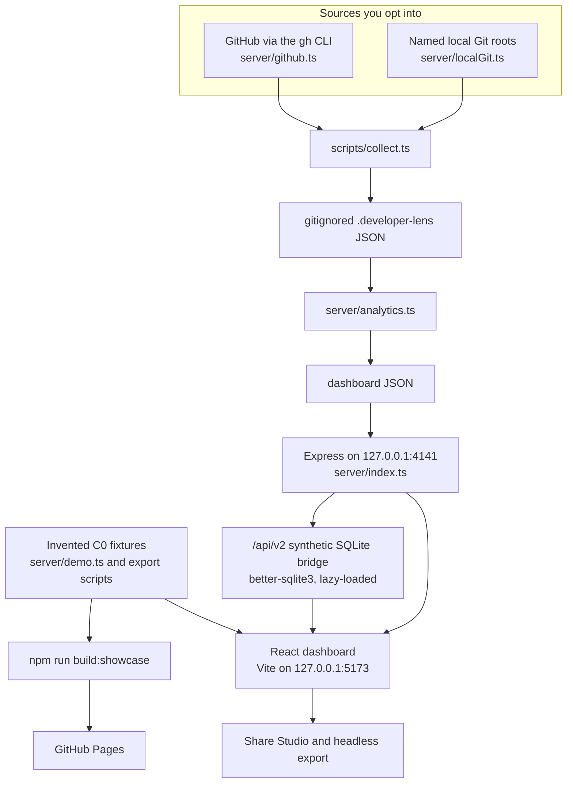

# Developer Lens

<p align="center"></p>

A local-first retrospective of a body of work: the evidence stays evidence, the pattern stays a calculation, and the hypothesis stays labelled.

[](https://github.com/Chris0Jeky/developer-lens/actions/workflows/pr-gate.yml)
[](https://github.com/Chris0Jeky/developer-lens/actions/workflows/pages.yml)
[](.github/workflows/pr-gate.yml)
[](LICENSE)

[Live synthetic showcase](https://chris0jeky.github.io/developer-lens/) ·
[Product direction](docs/PRODUCT_DIRECTION.md) ·
[Roadmap](ROADMAP.md) ·
[Data charter](docs/data-charter.md) ·
[Showcase walkthrough](docs/SHOWCASE_DEMO.md)

The public site is invented projects and events. It cannot sign in to GitHub. It does not contain a private dashboard, a credential, a local export, or anyone's repository history.

## What it is

Contribution graphs count activity. Developer Lens asks a sharper question: **what kind of development system did this body of work become?**

Where did attention sit, how did changes actually land, which rhythms repeated, and where is the record thin, censored, or contradictory? The answer is for a developer or a team inspecting their own work. It is not a productivity score, a performance monitor, an employee ranking, or a hosted analytics service.

Four layers stay separate:

1. **Observed evidence** — what an authenticated GitHub session or an explicitly selected local Git root actually exposed.
2. **Derived patterns** — deterministic calculations over those observations.
3. **Hypotheses** — interpretations that carry confidence, limitations, counter-evidence, and a question that could change the reading.
4. **Operator decisions** — the human choices about sources, capabilities, publication, and what to look at next.

Missing, censored, stale, restricted, refused, or failed evidence is never rewritten as zero. The analytical engine that ships is deterministic. Optional model assistance is not part of collection or the dashboard; the external-model capability stays `never_authorized` until a separate bounded activation lands.

## Features

What the running product actually does:

- Six- and twelve-month lenses over commits, pull requests, merges, reviews, issues, active days, streaks, languages, and repository concentration.
- A project constellation you can size by attention, pull-request flow, or continuity (`src/components/RepoConstellation.tsx`).
- Rhythm, burst periods, cross-repository overlap, delivery loops, and quiet craft (tests, docs, refactors, fixes) classified from commit subjects. The raw subject is not stored.
- Six-axis development DNA — Focus, Shipping, Collaboration, Consistency, Breadth, Stewardship — and a plain-language builder archetype. Both are deterministic readings of the same aggregates, not a score of the person (`server/analytics.ts`).
- Signal Lab cards for integration window, change-batch shape, coordination regularity, feedback surface, cadence concentration, and portfolio transition. Each card shows its formula, basis, and limit.
- Evidence drawers with confidence, source coverage, limitations, missingness, and counter-hypotheses.
- An interactive dashboard and a nine-chapter Wrapped narrative, with Share Studio cards, captions, a compact report, and self-contained portable dashboard and Wrapped files.
- An offline V2 story at `/?demo=v2`, and a coverage cockpit at `/?view=cockpit-v2` once `npm run seed:v2` has written the synthetic store and the local API is running.
- An Integration Shape Atlas (`/?view=integration-shape`), including a synthetic change-batch tail (opened-to-merge quantiles, censored strata, clickable evidence walks). The hosted and offline Atlas use invented data. The stored local endpoint `GET /api/v2/lenses/change-batch-tail` is default-off and answers 404 until a stored source is wired (`server/api/v2/changeBatchTail.ts`).
- A frozen Method Trial (`/?view=method-trial`): a candidate matched the baseline detection rate and raised false alerts, so the candidate was rejected and the deterministic baseline kept. "Benchmarked" is not "shipped."

## Architecture



`npm run collect` writes the private raw dataset and the analysed dashboard as JSON under `.developer-lens/`. `npm run analyze` rebuilds the dashboard from that raw file. The legacy API serves `/api/health`, `/api/status`, and `/api/dashboard`. `/api/v2` loads on first use, binds the same loopback host, and keeps its synthetic bridge store in gitignored `.developer-lens-synthetic/` so invented fixtures never share a directory with private runtime data.

`server/analysisPack/` builds coverage packs with SQLite and replays them through an in-memory DuckDB. That path is not the default collector.

The opt-in V1-to-SQLite importer (`server/storage/migrateV1.ts`, separate from the default JSON collector) publishes a first store with a hard link so it cannot overwrite another importer's store. If the filesystem or its policy refuses that operation (`EPERM`, `ENOTSUP`, `EOPNOTSUPP`, `ENOSYS`, or `EXDEV`), reader selection keeps `legacy-json` and returns the content-free code `storage-publish-unavailable`. Use a writable store location that supports hard links and retry. The original JSON stays untouched and the staged database is removed; the importer never substitutes an overwriting rename.

`server/connectors/github/` and `server/externalModel/` hold default-off activation code for a bounded GitHub-core reader and an OpenAI payload preview. Neither is called by `npm run collect`. `cap.external.model` remains `never_authorized`.

Two surfaces, one codebase:

| Surface | Data | Boundary |
| --- | --- | --- |
| Public showcase | Invented C0 repositories and events | Static GitHub Pages artifact |
| Local lens | Authenticated public and private GitHub activity, plus Git roots you name | API bound to `127.0.0.1` |
| Portable export | A pre-redacted aggregate the operator selects and acknowledges | Self-contained local file |
| CommitAtlas projection | `PublicLensProjection.v1`, reviewed before any publication | Owner-gated tracked artifact, never ambient sync |
| Developer Lens Lab | Separate research environment and method qualification | No automatic promotion into the product |

The showcase build regenerates synthetic data, checks synthetic identities, rejects repository and pull-request URLs, and scans the built artifact for credentials and local paths before Pages deployment.

## Quickstart

The hosted gate proves on **Node.js 24**. Vite 8 needs `^20.19.0 || >=22.12.0`, so an older 20.x or 22.x will not build. Use one Node major per install: `better-sqlite3` is ABI-specific. On Windows, use PowerShell and quote paths.

### Offline demo

No GitHub account and no private data.

```powershell
npm ci
npm run dev:web
```

Open <http://127.0.0.1:5173/?demo=v2>.

The web port is pinned. If 5173 is busy, Vite fails instead of moving to a host the V2 allowlist does not trust. Other routes that do not need the API:

- `/?view=integration-shape` — invented comparative integration finding, including the synthetic change-batch tail
- `/?view=method-trial` — frozen candidate-versus-baseline decision

`/?view=cockpit-v2` is not offline. It fetches `/api/v2/coverage` and `/api/v2/capabilities`. Run `npm run seed:v2`, then `npm run dev`, and open <http://127.0.0.1:5173/?view=cockpit-v2>.

The Integration Shape and Method Trial routes also work on the hosted showcase.

### Private local lens

You need Git and an authenticated [GitHub CLI](https://cli.github.com/) session for the repositories you want included. Developer Lens spawns `gh` and does not read or persist the token (`server/gh.ts`).

```powershell
npm ci
gh auth status
npm run collect -- --local-root "C:\path\to\repos"
npm run dev
```

Open <http://127.0.0.1:5173>. `npm run dev` runs the API and Vite together. The API defaults to <http://127.0.0.1:4141>; `DEVELOPER_LENS_PORT` moves it and the dev proxy follows. `npm start` serves a production build from the same loopback API.

Collection defaults to both `6m` and `12m`. Pass `--range 6m` or `--range 12m` to narrow a run. Repeat `--local-root`, or set `DEV_LENS_LOCAL_ROOTS` as in [`.env.example`](.env.example). With no private dataset, the UI falls back to a clearly labelled synthetic demo.

Local Git history is opt-in. Only roots passed with `--local-root` or `DEV_LENS_LOCAL_ROOTS` are scanned, and only aggregate commit features are written. Developer Lens does not search the machine for repositories. Local attribution uses configured email identities (`user.email` and `DEV_LENS_GIT_EMAILS`), not author-name matching.

Git marker files do not extend selected-root consent: the resolved worktree top-level, Git directory, and common directory must each be inside an explicitly selected root and outside protected discovery paths (ordinary `.git` metadata is allowed). A linked worktree whose shared metadata is outside every selected root is refused until its containing root is also explicitly selected. Refusal records incomplete coverage with `LOCAL_GIT_BOUNDARY_REFUSED`, without exposing the refused path. The check runs before any history read (only `git rev-parse` touches the candidate first). Object alternates (`objects/info/alternates`) are not confined.

### Sharing and export

```powershell
npm run export:artifacts
```

With no flags, this writes a complete synthetic showcase set into gitignored `artifacts/`: overview and chapter cards, caption tones, a report, a portable dashboard, a portable Wrapped, dashboard JSON, and a manifest for both ranges.

A local export refuses unless you pass `--source local --acknowledge-redaction`. It defaults to `--repository-redaction all-aliases` and never writes the raw local dashboard record. Re-running an export removes only files named by its previous manifest, and it refuses to clear an unrelated populated directory.

The public URL always opens the synthetic showcase. Developer Lens does not create a hosted URL for a private dashboard.

#### Export deliberately

```powershell
npm run export:profile
npm run export:profile -- --source local --acknowledge-redaction --range 12m
```

`export:profile` writes one `PublicLensProjection.v1` file (`lens-profile.v1.json`) plus a manifest into gitignored `profile-export/`, through the same scans and manifest-scoped replacement as `export:artifacts`. The default `--source showcase` is C0 synthetic data. `--source local` is the owner's C1 `redacted-local` projection: it refuses without `--acknowledge-redaction`, defaults to `--repository-redaction private-aliases` (`all-aliases` is available), and is never published to Pages or committed as a fixture. Schema, C0 fixture, coverage-score scale, and warning codes: [`research-contracts/lens-projection/v1/`](research-contracts/lens-projection/v1/README.md).

Aliases reduce identification risk. They are not an anonymity guarantee. Aggregate numbers can still describe your activity.

Files are built in memory, scanned before writing, scanned again after writing, and removed if a privacy guard fails. Cleanup preserves unrelated files or folders added to the output directory during the export.

## Tech stack

| Piece | Role |
| --- | --- |
| TypeScript ~6, React 19, Vite 8 | Dashboard, Wrapped, Atlas, cockpit, Share Studio (`src/`) |
| Express 5 | Loopback API (`server/index.ts`) |
| Vitest, Testing Library, Oxlint | Tests and lint; `npm run check` runs them with the production build |
| Zod | Closed contracts for projections, findings, and packs |
| better-sqlite3 12 | V2 synthetic bridge and storage modules; not loaded by the offline demo |
| DuckDB (`@duckdb/node-api`) | In-memory replay inside analysis packs |
| date-fns, Recharts, Framer Motion | Windows, charts, and motion in the dashboard |
| Node.js 24 | Version the PR gate and Pages workflow install |

`package.json` is `"private": true` and `"version": "0.0.0"`. There is no published npm package.

## Status and roadmap

Checked against this tree and GitHub on 12 October 2026: `main` has no release and no tag. `package.json` is still `0.0.0`. The `v0.1.0` tag waits on the owner's five-minute aesthetic sign-off in [`HUMAN_TODO.md`](HUMAN_TODO.md) (q-10(c)). Existing synthetic Pages publication is already allowed.

Direction, not a schedule. Detail lives in [`ROADMAP.md`](ROADMAP.md) and [`docs/PROGRAMME_ROADMAP.md`](docs/PROGRAMME_ROADMAP.md).

**Now.** [Issue #200](https://github.com/Chris0Jeky/developer-lens/issues/200) is the open `v0.1.0` release programme. The baseline it would tag is already in the tree: synthetic showcase, offline V2 demo, coverage cockpit, frozen Method Trial, local retrospective, and the export boundary.

**Next.** [`ROADMAP.md`](ROADMAP.md) still names one integrated evidence vertical: how long integration work takes to land, and what the tail looks like. [Issue #174](https://github.com/Chris0Jeky/developer-lens/issues/174), which tracked the stored-observation bridge, is closed completed. What shipped is the synthetic change-batch tail on the Atlas. The stored route stays default-off. Kaplan–Meier and accelerated-failure-time curves are roadmap text; they are not a view under `src/`.

**Then.** [Issue #201](https://github.com/Chris0Jeky/developer-lens/issues/201) is the open data-charter follow-on: layered classes and explicit capability profiles. Actions, Deployments, and Source Structure can form one opt-in profile for repositories you select. Dependencies, security aggregates, discussions, text-rich inspection, model assistance, team mode, and external sinks stay separate capabilities, each with its own consent, budget, retention, deletion, and refusal rules. Code on disk is not an active collector. [Issue #202](https://github.com/Chris0Jeky/developer-lens/issues/202) still holds the pre-activation checks those profiles need.

**Later.** [Issue #203](https://github.com/Chris0Jeky/developer-lens/issues/203) is deterministic local recommendations first, only when an analysis run materially changes, with a deterministic mode that stands alone. Optional model-generated hypotheses would stay labelled and cost-capped. [Issue #205](https://github.com/Chris0Jeky/developer-lens/issues/205) lists a `gh` launcher, an npm CLI, and a desktop shell. None of that is shipped.

**Not planned.** Individual scoring or a surveillance metric in the stable product. Publishing non-invented data through the public site. A hosted service that holds your history.

## Private by construction

Raw private collection output stays under gitignored `.developer-lens/`. A local export (`--source local`) writes its redacted C1 projection into gitignored `artifacts/` or `profile-export/`, so treat those directories the same way. Do not publish any of them, raw screenshots, or browser exports without reading them.

`npm run collect` stores, in the private raw file:

- repository identity the API returned (name, URL, description, languages, topics, private/archived/fork flags);
- pull-request titles, numbers, URLs, timestamps, draft state, and size counts;
- commit SHAs, timestamps, optional line and file counts, and subject *features* (conventional type, revert, fixup, subject length);
- your GitHub login, plus name and avatar URL when GitHub returns them;
- dated review and issue events without bodies.

It does not store repository file contents, diffs, filenames, issue or pull-request bodies, raw commit subjects, or Git credentials. The collector prints that boundary when a run finishes.

Loopback is not a defence against other trusted local processes. The V2 API closes the browser drive-by surface it declares: exact Host and Origin allowlists, fetch-metadata checks, and no CORS headers (`server/api/v2/mount.ts`).

### Usage measurement on the public showcase

Only `npm run build:showcase` emits the locked Pulseboard SDK (`observatory/pulseboard.js`, SDK `3.3.1`, hash-pinned in [`observatory.lock.json`](observatory.lock.json)). Local and private builds, your datasets, share artifacts, and portable exports never load it. `npm run build` fails if `dist` mentions Pulseboard; `verify:showcase` checks the showcase page and the export outputs. Product calls in `src/lib/showcaseUsage.ts` compile away outside `--mode showcase` and fire only for the `public-demo` dataset.

The locked SDK, not a separate policy page in this repo, implements the notice:

- A **Beta** bar names the collection and offers **Choose** and **OK**. After a choice, it collapses to a Beta button that reopens the switches.
- Three categories: **Usage counts** (aggregate page and feature counts), **Diagnostics** (speed, errors, and time on page), and **Journeys and product data** (a random id for one browser tab, plus ordered showcase events such as which view opened and which share control was used).
- Outside the EEA, all three start on and any of them can be turned off. In the EEA, or when the region is still unknown, only usage counts start on, and diagnostics and journeys wait until you click OK.
- Global Privacy Control or Do Not Track turns all three off.
- The SDK header states that no IP, user agent, page URL, referrer path, or cross-visit id is read into a payload. Showcase events from this repo send closed enums only: route, range, and share channel. Captions, repository names, titles, and export contents are not props (`src/lib/showcaseUsage.ts`).
- The artifact stays inert off `https://chris0jeky.github.io` and under automation. `observatory/README.md` records that the collector stores nothing until Pulseboard lists this project; this repository does not assert that listing.

Retention windows for that collector live in Pulseboard's usage plan, which is not vendored here.

## Verification

```powershell
npm run check
npm run build:showcase
```

`check` runs toolchain preflight, Oxlint, context verification, generated-contract drift checks, the Vitest suite, and the production build. `build:showcase` exports synthetic ranges, builds for GitHub Pages (`--base=/developer-lens/`), and runs the public-boundary scan.

The required pull-request check is **Prove the pull request** (`.github/workflows/pr-gate.yml`). Pushes to `main` run **Deploy public showcase** (`.github/workflows/pages.yml`), which repeats the full local gate, the showcase build, and `node observatory/check.mjs` before upload.

Three more workflows are real and path-filtered, so they do not run on every pull request:

- `windows-test-roots.yml` — native Windows test-root proof
- `atlas-pointer-smoke.yml` — Atlas pointer evidence when UI or export inputs change
- `dependency-audit-evidence.yml` — npm audit evidence collection; a green job does not accept or dismiss findings

For continued development, start with [`CLAUDE.md`](CLAUDE.md). [`AGENTS.md`](AGENTS.md) is the Codex adapter. [`docs/analyser-program/CURRENT_STATE.md`](docs/analyser-program/CURRENT_STATE.md) is the live resume artifact. [`HUMAN_TODO.md`](HUMAN_TODO.md) is the only source for owner decisions.

## Cross-project contracts

- Developer Lens owns analysis semantics and redaction.
- Developer Lens Lab owns method research and qualification. It cannot emit "ship" as a research decision.
- CommitAtlas consumes only pinned, product-owned, public-compatible projections and never fetches the private lens.
- Pulseboard measures the synthetic public showcase only, through the locked SDK the showcase build emits.
- Taskdeck integration remains a reviewed proposal, not ambient task creation.

`DeveloperLensMethodTrialSummary.v1`, `ResearchFindingProjection.v1`, and `PublicLensProjection.v1` are the producer-first examples: this repo defines semantic acceptance, producers satisfy it, and consumers validate the pinned artifact.

## Documentation

- [Product direction](docs/PRODUCT_DIRECTION.md)
- [Roadmap](ROADMAP.md)
- [Programme roadmap](docs/PROGRAMME_ROADMAP.md)
- [Owner constitution](docs/OWNER_CONSTITUTION.md)
- [Data charter](docs/data-charter.md)
- [Source and capability matrix](docs/source-capability-matrix.md)
- [V2 architecture](docs/DEVELOPER_LENS_V2_ARCHITECTURE.md)
- [Current analyser state](docs/analyser-program/CURRENT_STATE.md)
- [Implementation ledger](docs/IMPLEMENTATION_LEDGER.md)
- [Showcase demo](docs/SHOWCASE_DEMO.md)
- [Observatory / Pulseboard boundary](observatory/README.md)
- [Lens projection contract](research-contracts/lens-projection/v1/README.md)

## Contributing

Read [`CONTRIBUTING.md`](CONTRIBUTING.md) before opening a pull request, then [`CODE_OF_CONDUCT.md`](CODE_OF_CONDUCT.md). Fixtures are invented. `.developer-lens/`, generated private data, real repository names, and real credentials do not belong in a branch. Ideas are welcome as [Discussions](https://github.com/Chris0Jeky/developer-lens/discussions) or issues.

There is no `SECURITY.md`. The code of conduct does not yet publish a private reporting channel. Do not put credentials, collected data, or vulnerability detail in a public issue.

## License

Copyright (C) 2026 Cristian Tcaci. Developer Lens is licensed under [GNU AGPL v3.0 only](LICENSE) (`AGPL-3.0-only`).

For commercial conversations, see [`COMMERCIAL_OPTION.md`](COMMERCIAL_OPTION.md). It states intent only and does not establish commercial terms.
